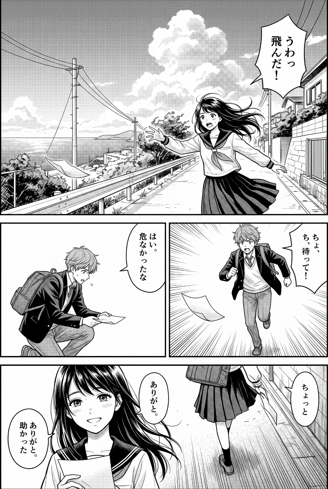
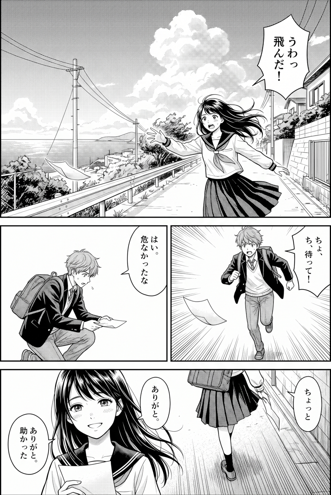
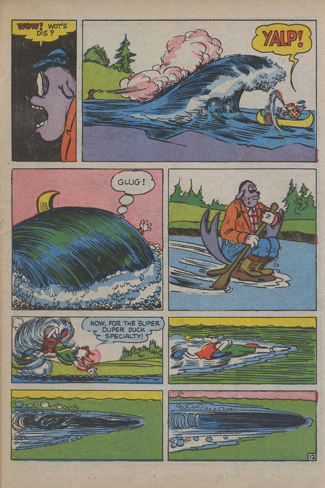
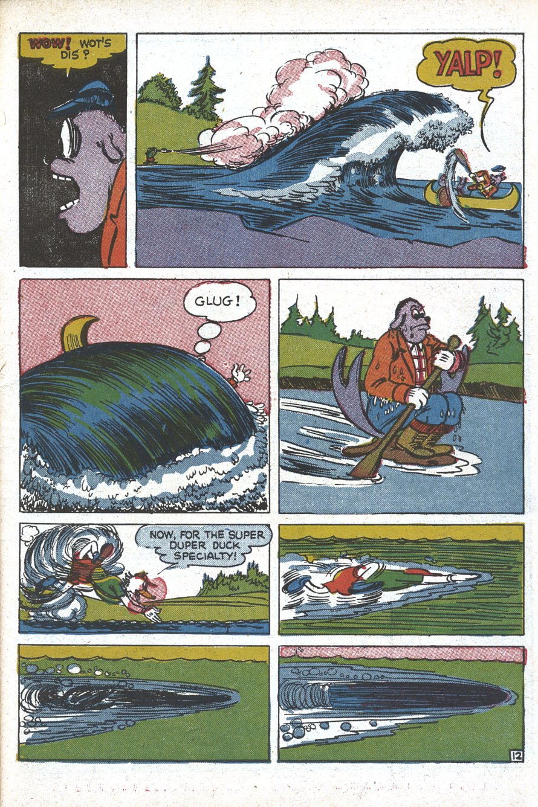
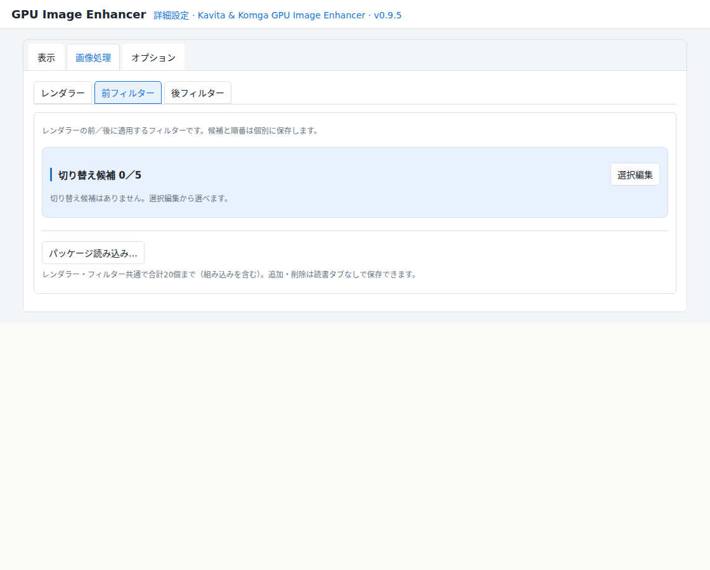
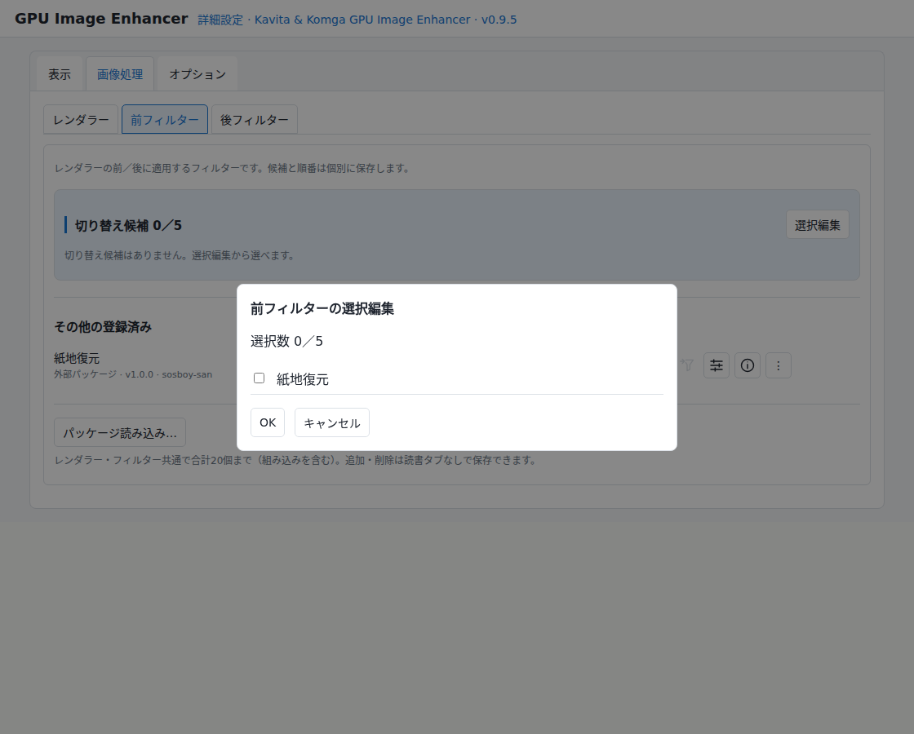

# Kavita & Komga GPU Image Enhancer

[日本語](README.ja.md) | [English](README.en.md)

**ブラウザーの漫画表示を、もっと自由に。もっと美しく。**

Kavita & Komga GPU Image Enhancer（GPUIE）は、Kavita・Komga向けのブラウザー拡張機能です。LoHalo Jr.・NoHalo Jr.などの拡大・縮小方式に、前後のフィルターを組み合わせて、専用コミックビューアのような本格的な画質調整を行えます。サイト本来のレイアウトや読書操作をなるべく維持しながら、漫画の見え方を好みに合わせられます。

現在の本体は **0.9.5 β**、公開モジュールAPIは **1.0** です。

## できること

### 拡大・縮小方式を選ぶ

漫画画像を画面に合わせて拡大・縮小する際に、※<u>LoHalo Jr.やNoHalo Jr.</u>などの高品質な画像処理方式を選べます。別配布のLanczos3を追加することもできます。

文字や線、網点などの見え方を比べながら、作品や表示サイズに合うものを選んでください。画像や倍率によって効果は異なります。

#### ※LoHalo Jr.・NoHalo Jr.という名前について

LoHalo Jr.とNoHalo Jr.は、GIMPで利用されているGEGLのLoHalo・NoHaloを基に、GPU Image Enhancer向けに実装した拡大・縮小処理です。

開発時にはGIMPの出力画像との比較検証を行い、検証用のサンプル画像では、8bit階調で各画素の差が±1程度に収まる結果を確認しました。
一方で、本拡張機能では縦横比を維持した拡大・縮小のみを扱っており、オリジナルのすべての処理を移植したものではありません。

そのため、オリジナルの開発者と優れたアルゴリズムへの敬意を込めて名称を受け継ぎ、独自の実装であることを区別するために「Jr.」を付けています。

### 前後のフィルターを組み合わせる

画像処理は、次の順序で行います。

**前フィルター → レンダラー → 後フィルター**

拡大・縮小の前に紙の色を整え、表示サイズに合わせた後で輪郭を調整する、といった組み合わせができます。各段で使用するモジュールを選び、調整値を保存できます。

### 読書中に切り替える

クイック操作からレンダラーやフィルターを切り替え、選択中のフィルターを調整できます。操作のたびに詳細設定へ移動する必要はありません。

次に読むページも先回りして準備。 キャッシュと先読み機能を組み合わせ、画質調整を使いながらも快適に読み進められるようにしています。

### 画像処理機能を追加する

外部モジュールを読み込むことで、フィルターやレンダラーを追加できます。本体の組み込み機能だけでなく、別途配布するモジュールパック（紙地復元や線色・濃度調整）などを選んで使えます。

## 実際の表示を比べる

### 縮小するときのスクリーントーンの見え方

同じ原画像を **1696×2528 → 1073×1600ピクセル（約63.3％）** に縮小した実際の表示です。空のスクリーントーンに現れるモアレと、髪・服・背景の細線、文字の見え方を比べてください。前後のフィルターは使用していません。

**Browser**

**LoHalo Jr.**

比較用の[原画像](site/assets/comparisons/manga-original.jpg)はAI（Gemini）で作成しました。BrowserとGPUIEのLoHalo Jr.で実際に縮小表示してキャプチャーしています。

※READMEの表示幅によって再縮小される場合があります。[紹介ページの比較表示](site/index.html#compare-resize)では、画素等倍表示や画像の切り替えで確認できます。見え方は元画像・縮小率・表示環境によって異なります。

### 紙の黄ばみを整える

Paper Restorationは、古い漫画の黄ばんだ紙を白い紙に近づける追加フィルターです。紙地の変化と、印刷された色の見え方を比べてください。

| 補正前 | 補正後 |
| --- | --- |
|  |  |

使用画像：『Super Duck』第2号、Komga公式デモ掲載。両方ともLoHalo Jr.で **1500×2250 → 898×1347ピクセル（約59.9％）** に縮小した実際の表示です。補正は自動モードです。作品によって結果は異なり、印刷色の完全な保護を保証するものではありません。

## 対応環境

| 対象 | 動作確認済み環境 |
| --- | --- |
| Komga | v1.27.1-master、※旧GUI |
| Kavita | 0.9.1.4 |
| PC | Chrome 155.0.8059.80（公式ビルド・64ビット） |
| Android | Edge Canary 157.0.4333.0（試験的・CRXの導入と動作を確認） |

※Komgaの新GUIは未検証です。

GPU処理にはWebGL2などの対応機能が必要です。拡張機能の最低Chromeバージョン指定は135です。Androidでは拡張機能とCRXの導入に対応したブラウザーが必要です。

**公開前の確認事項：** サイト別の実機確認済み表示モードを追記します。

## [ダウンロードとインストール](https://github.com/sosboy-san/Kavita-Komga-GPU-Image-Enhancer/releases/tag/v0.9.5-beta)

| 配布物 | 用途 |
| --- | --- |
| 本体ZIP | PCで展開して読み込む拡張機能 |
| 本体CRX | Androidの確認済みブラウザー向け |
| モジュールパックZIP | 任意で追加するフィルター・レンダラー |

追加モジュールは必須ではありません。本体にはLoHalo Jr.、NoHalo Jr.、GPUアンシャープマスクが組み込まれています。公式リポジトリは[Kavita-Komga-GPU-Image-Enhancer](https://github.com/sosboy-san/Kavita-Komga-GPU-Image-Enhancer)です。[Releaseページ](https://github.com/sosboy-san/Kavita-Komga-GPU-Image-Enhancer/releases/tag/v0.9.5-beta)から本体ZIP・CRX・追加モジュールをダウンロードできます。

### PC：Chrome

1. [Releaseページ](https://github.com/sosboy-san/Kavita-Komga-GPU-Image-Enhancer/releases/tag/v0.9.5-beta)から本体ZIPをダウンロードし、フォルダーへ展開します。
2. Chromeで拡張機能の管理画面を開きます。
3. デベロッパーモードを有効にします。
4. 「パッケージ化されていない拡張機能を読み込む」から、manifest.jsonが入っているフォルダーを選びます。
5. 必要に応じて、ツールバーに拡張アイコンを固定します。

外側の配布一式ZIPに本体ZIPが入っている場合は、本体ZIPも展開してください。選ぶのはソース全体のフォルダーではなく、manifest.jsonが直接入っている拡張機能のフォルダーです。

### Android：Edge Canary

Android向けには本体CRXを用意しています。**Edge Canary 157.0.4333.0で、CRXの導入と動作を確認しています。**

Canary版での試験的な利用となり、正式な対応を保証するものではありません。ブラウザーの更新によって、導入方法が変わったり、動作しなくなったりする場合があります。

### 外部モジュールを使う場合

ブラウザーの拡張機能設定で、GPU Image Enhancerのユーザースクリプト実行を許可してください。ブラウザーの版によって許可設定の場所が異なります。許可がない場合、モジュールを保存できても実行できません。

この許可は、GPU Image Enhancerの詳細設定にある開発者モードとは別のものです。

## 最初の設定

### 1. 読みたいサイトを登録する

Kavita・Komgaのタブを開き、拡張アイコンからサイトを登録します。接続先と設置パスを確認し、ブラウザーが求めるサイトへのアクセス権限を許可してください。

例えば、同じサーバー上の別の設置場所を使う場合も、登録したポートとパスに合うページを対象とします。登録サイトの管理は詳細設定から行えます。

### 2. 本体のON／OFFを確認する

本体の初期設定はONです。登録サイトの読書画面で、本体がONになっていることを確認してください。

拡張アイコンは、現在のタブの登録状態と本体のON／OFFを示します。

| アイコン | 状態 |
| --- | --- |
|  灰色の本・灰色のGPU | 未登録サイト |
|  白い本・灰色のGPU | 登録済み、本体OFF |
|  白い本・緑のGPU | 登録済み、本体ON |

緑のGPUは本体がONであることを示します。現在描画中かどうかを示す表示ではありません。登録サイトの一覧画面など、読書画面以外の画像を一律に加工するものでもありません。

### 3. レンダラーを選ぶ

**初期状態ではBrowserが選択され、フィルターは未選択です。** 

LoHalo Jr.またはNoHalo Jr.を選んで見え方を比べ、必要に応じてフィルターを加えてください。

## 基本的な使い方

サイトの読書メニューを表示すると、クイック操作を利用できます。

| アイコン | 操作 | 内容 |
| --- | --- | --- |
|  | 本体ON／OFF | 画像処理全体を切り替える |
|  | 前フィルター | 拡大・縮小前のフィルターを切り替える |
|  | レンダラー | 拡大・縮小方式を切り替える |
|  | 後フィルター | 拡大・縮小後のフィルターを切り替える |
|  | 調整 | 現在選択中の処理の調整画面を開く |
|  | HUD | 表示状態などの情報を表示・非表示にする |
|  | 詳細設定 | 候補、配置、キャッシュ、言語などを設定する |

レンダラーと前後のフィルターは、詳細設定で選んだ候補を順に切り替えます。クイック候補は各対象で最大5個です。前後のフィルターはOFFにも切り替えられます。

クイック操作の配置は、縦向き・横向きごとに設定できます。
### 調整値を変更する

フィルターの調整画面で値を変更し、適用して保存します。項目はフィルターによって異なります。

PCではスライダーをクリック・ドラッグし、数値を直接入力することもできます。タッチ端末でもスライダーと数値入力を使えます。数値の横の操作はPCとタッチ端末に合わせて表示されます。

同じフィルターを前後の両方で使う場合も、調整値は別々に保存されます。選択を切り替えると、開いている調整画面も選択中のフィルターへ追従します。

使い方や注意点は、そのモジュールのInfoにある作者の説明を確認してください。

### 詳細設定から読書へ戻る

読書タブから詳細設定を開いた場合は、左上の戻る操作で元の読書タブへ戻り、設定タブを閉じます。単独で開いた場合は閉じる操作になります。未適用の編集がある場合は確認が表示されます。

### 言語を切り替える

日本語・英語・自動を選べます。自動はブラウザーの言語に合わせ、未対応の言語では英語を表示します。言語変更を確認して保存すると、設定タブを再読み込みします。

外部モジュールの表示文は、そのモジュールに含まれる翻訳を使用します。選択した言語の翻訳がない項目は英語へ戻ります。

## 組み込みの画像処理

| 名前 | 役割 |
| --- | --- |
| Browser | ブラウザー標準の拡大・縮小 |
| LoHalo Jr. | GEGLのLoHaloを基にした読書用途向けの拡大・縮小 |
| NoHalo Jr. | GEGLのNoHaloを基にした読書用途向けの拡大・縮小 |
| GPUアンシャープマスク／GPU Unsharp Mask | 拡大・縮小後の輪郭調整 |

### GPUアンシャープマスク

輪郭の強調は、半径・強度・閾値で調整します。

| 項目 | 内容 | 初期値 |
| --- | --- | --- |
| 半径 | ぼかしの広がり。出力画素単位のGaussian sigma | 3 |
| 強度 | 元画像とぼかした画像の差を加える量 | 0.5 |
| 閾値 | 強調するRGB各成分の差の基準。8bit階調差 | 0 |

カラー・モノクロの両方に使えます。半径または強度を0にすると素通しになります。

強くかけすぎると、線の周囲の縁取りやざらつきが目立つ場合があります。小さな変更から試してください。

## 追加モジュールを使う

次の3本は**本体とは別配布**です。必要なものだけを追加できます。

| 名前 | できること |
| --- | --- |
| Paper Restoration／紙地復元 | 古い漫画の黄ばんだ紙を白い紙に近づけ、紙色のむらも補正 |
| Monochrome Line Color／カラー判定付き線色・濃度調整 | カラーページを保護し、モノクロページの線色と濃さを調整 |
| Lanczos3 | 拡大・縮小方式の選択肢を追加 |

### 紙地復元

画像ごとに紙色を自動推定して補正します。手動で基準色を指定することもできます。印刷色や暗い線をなるべく残しながら、黄ばみを減らす用途に使えます。

印刷色を完全に保護できるわけではありません。紙色に近い印刷色が変わる場合があるため、補正の強さや色の保護を調整してください。

### 線色・濃度調整

モノクロページと判定した画像の線色や濃さを変えられます。カラーページの保護の強さを変える判定モードと、判定を無視して適用するモードがあります。

自動判定は万能ではありません。小さなカラー部分を取りこぼす場合などもあります。作品に合わせてモードを選んでください。

### パッケージ追加のチュートリアル

初めて外部モジュールを使うときは、ブラウザーの拡張機能設定でGPUIEのユーザースクリプト実行を許可してください。

1. **モジュールパックを展開する。** ZIPの中から、使いたい `.js` または `.txt` ファイルを用意します。
2. **詳細設定の「画像処理」を開く。** レンダラーは「レンダラー」、紙地復元などは「前フィルター」または「後フィルター」を選びます。
3. **「パッケージ読み込み…」でファイルを選ぶ。** ZIPではなく、展開したモジュールのファイルを選んでください。

4. **「選択編集」で候補に入れる。** 追加したモジュールにチェックを入れ、「OK」で確定します。

5. **読書画面で切り替える。** 対応するクイックアイコンを押して追加したモジュールを選び、「調整」で好みに合わせます。

画面は現在のUI実装を使った説明用の再現です。PC・タッチ端末で配置が異なる場合があります。モジュールの使い方はInfoを確認してください。

登録上限は組み込みを含め合計20個、各ファイルは1 MiB以下です。

**外部モジュールは実行可能なJavaScriptです。信頼できる配布元のものだけを使用してください。** 宣言の検査や処理の分離は、任意のコードの安全性を保証するものではありません。

## 速度とメモリの設定

### 処理済み画像の形式

| 形式 | 特徴 |
| --- | --- |
| PNG | 出力時の圧縮による画質劣化を避ける。初期設定 |
| JPEG | 品質90。速度とキャッシュ容量を優先。透明部分は白になる |

これは処理済み画像の形式です。どちらが速いか、どの程度の差になるかは端末と画像によって変わります。

### キャッシュと先読み

近いページは展開済みで保持し、その先の前方ページは圧縮済み画像として準備します。

| 設定 | 選択肢・初期値 |
| --- | --- |
| 展開済み画像の保持数 | 前後それぞれ2・4・8画像。初期値4／4 |
| 圧縮済み画像の容量 | 64・128・256 MB。初期値PNG 128 MB、JPEG 64 MB |

現在表示中の画像は、キャッシュの保持数とは別に管理します。
圧縮済み画像の容量は保存形式ごとに設定でき、表示中の画像を優先するため、一時的に設定容量を超える場合があります。

先読みは通常の読書画面でも動作します。さらに、サイト内の全画面表示では、表示サイズが確定した後に、より先のページまで処理を進めます。

※ キャッシュ容量の設定値は、ブラウザー全体のメモリ使用量を示すものではありません。
### 処理方式と時間制限

通常はWorkerで処理します。画像処理の時間制限は1〜60秒、初期値10秒です。画像のエンコードには別の30秒の制限があります。

速度優先モードでは、長い同期JavaScriptを強制停止できません。外部モジュールによっては操作が長く止まる可能性があるため、注意して使用してください。

## 困ったとき・注意事項

### 画質が変わらない

- サイトが登録され、アクセス権限が許可されているか確認してください。
- 本体がONか、Browser以外のレンダラーまたはフィルターを選択しているか確認してください。
- 調整値を適用したか、エラーやサイズ制限が表示されていないか確認してください。

等倍表示ではレンダラーの拡大・縮小を省略します。選択中のフィルターは実行します。

### 外部モジュールが動かない

ブラウザー側でユーザースクリプトの実行が許可されているか、対応APIと表示されるエラーを確認してください。必要に応じて読書タブを再読み込みしてください。

### 処理が失敗する・遅い

画像サイズ、端末のGPU、選択した処理によって速度と必要なメモリは変わります。通常の処理失敗では原画表示へ戻ります。

設定を軽くする、フィルターを外す、出力形式をJPEGへ変更するなどを試せます。必要に応じて一般設定から画像処理を再試行してください。

### 画像サイズと動作範囲

一般Webページの画像を一律に加工するのではなく、Kavita・Komgaのリーダー画像を対象にします。

ただし、次の上限はあります。

| 制限 | 内容 |
| --- | --- |
| 現在表示の出力 | 最大6,400万画素 |
| 先読みの出力 | 最大1,600万画素 |
| GPU寸法 | 端末のGPU・ブラウザーの上限を適用 |
| GPU作業領域 | 512 MiB （ブラウザー全体のRAM上限ではありません）|
| 処理時間 | 設定した制限時間を適用 |

大きな画像などでは、現在画像を表示できても前後の先読みを準備できない場合があります。

### その他の制約

- Komgaの新GUIは未検証です。
- サイトの画面構造が変わると、動作しなくなる場合があります。

不具合を報告する際は、本体・サイト・ブラウザーの版、表示モード、使用中のモジュール、再現手順を添えてください。認証情報や個人情報を含むログを、そのまま公開しないでください。

**公開前の確認事項：** 不具合報告先のリンクを追加します。

## 権限とデータの取り扱い

| 権限 | 用途 |
| --- | --- |
| storage | 設定、サイト登録、追加モジュールの保存 |
| scripting | 登録サイトへの処理コードの読み込み |
| activeTab | 利用者が操作した現在のタブを対象にする |
| userScripts | 外部モジュールの実行 |
| 任意のHTTP／HTTPSサイト権限 | 利用者が登録するサーバーへの接続 |

任意の接続先を登録できるため、ブラウザーに宣言するサイト権限の候補は広い範囲です。実際のサイトアクセスは登録時に許可します。ブラウザーの許可はホスト単位ですが、拡張機能は登録したポートと設置パスも照合します。

設定と追加モジュールはブラウザーのローカル保存領域に保存します。処理済み画像のキャッシュは読書ページ内で保持し、原画像ファイルを書き換えません。

組み込みの画像処理に、外部の画質処理サービスへ画像を送信する仕組みはありません。ページ情報の取得には登録サイトのAPIと既存のログイン状態を利用します。

### 診断情報

開発者向け診断は通常OFFです。ONにすると解析結果や処理時間などを確認し、JSONをコピー・保存できます。診断記録は読書ページ内のメモリに保持され、再読み込みやページ終了で消えます。

本体は診断JSONへ画像URL・認証情報・ファイルパス・画素を追加しません。ただし、追加モジュールが返す文字列などは含まれるため、共有前に内容を確認してください。

## ライセンス・クレジット

作者：**sosboy-san**

LoHalo Jr.・NoHalo Jr.はGEGLの実装を基にしており、原作者のクレジットとLGPL-3.0-or-laterの表記を維持しています。Crisp Images由来部分にはMITライセンスが適用されます。

原作者・出典・ライセンス文書は、同梱資料と各モジュールのInfoを参照してください。

GPUIEの開発・移植・改修・保守はsosboy-sanが担当します。Crisp Images由来部分の原作者はIkkoru（旧表記：Igkor Bevzenidis）、LoHalo Jr.・NoHalo Jr.の原アルゴリズム・コードはGEGLの各原作者によるものです。原作者クレジットは、GPUIEが原作者による公式版・推奨であることや、原作者がサポートすることを示すものではありません。不具合報告はGPUIE側へお願いします。

GPU Unsharp Mask・Paper Restoration・Monochrome Line ColorはMITライセンスで配布します。第三者由来部分のライセンスは、それぞれの表記を維持します。

開発支援：OpenAI ChatGPT / Codex。設計の検討、実装、検証、文書整備に活用しています。

本体の独立した自作部分・README・公開API仕様書・公式紹介ページもMITライセンスです。第三者由来コードのライセンスは維持し、漫画などの比較素材はこのMIT指定に含めません。詳しくは[ライセンスの適用範囲](LICENSE.md)と[第三者クレジット](THIRD-PARTY-NOTICES.md)を参照してください。

## モジュールを作りたい方へ

公開GPUモジュールAPI 1.0で、レンダラーやフィルターを作成できます。調整画面の生成、元画像のCPU解析、解析結果を使ったGPU処理などに対応しています。

英語の表示情報を必須とし、日本語などの追加言語もモジュールに同梱できます。

詳しくは[公開GPUモジュールAPI仕様書 1.0](GPU-Module-API-Spec-ja-1.0.md)を参照してください。別配布モジュールも実装例として利用できます。
