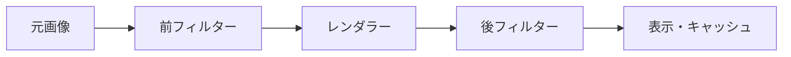
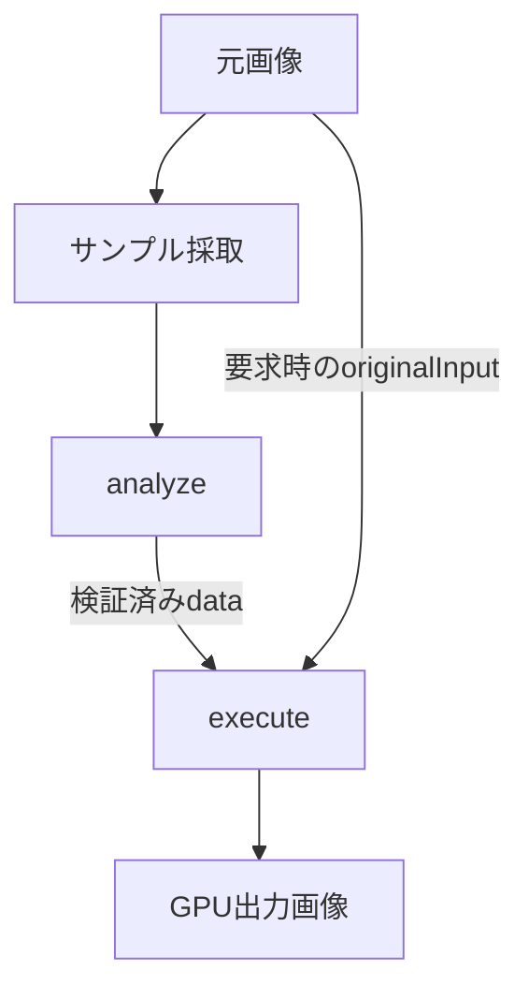
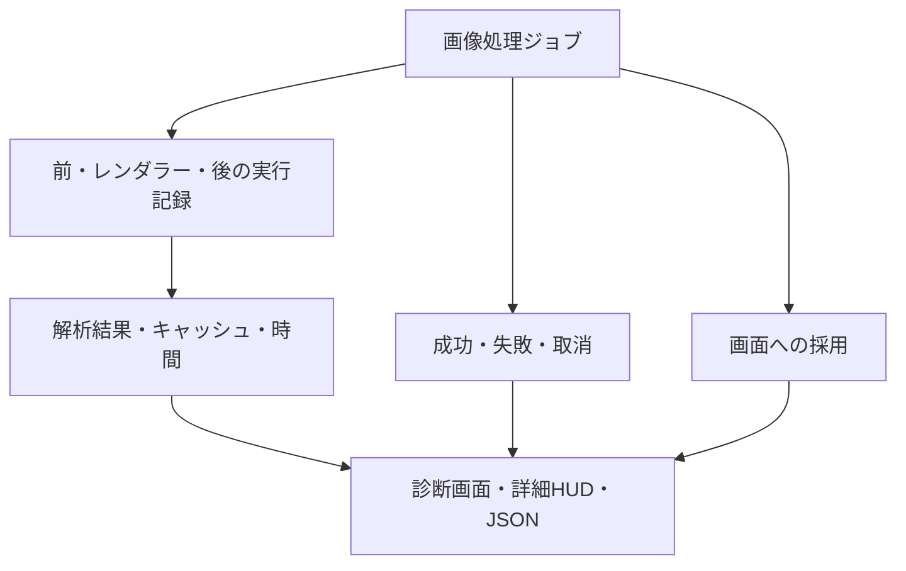

# Kavita & Komga GPU Image Enhancer 公開GPUモジュールAPI仕様書 1.0

レンダラー・フィルターの作者向け仕様です。

初めて作る場合は[最初のフィルターを作る](https://github.com/sosboy-san/Kavita-Komga-GPU-Image-Enhancer/blob/main/docs/Module-Quickstart-ja.md)（[English](https://github.com/sosboy-san/Kavita-Komga-GPU-Image-Enhancer/blob/main/docs/Module-Quickstart-en.md)）から始めてください。動作するサンプルと、修正・再登録の手順があります。

| 項目 | 値 |
| --- | --- |
| 公開API | 1.0 |
| 対応本体 | 0.9系以降（本仕様対応版） |
| moduleApiVersion／executionApiVersion | 1／1 |
| パッケージ版 | モジュールごとに独立管理。例：1.0.0 |
| 対象 | GPUレンダラー・フィルター。CPU解析・調整項目はフィルターのみ |

1〜4項は宣言と画面、5〜7項は画像処理、8〜9項は制限と使用規則、10項は提供範囲、11項は検証方法です。コード断片は説明用で、必要な宣言と組み合わせて使います。各例のラベルキーはtranslations.en.labelsにも登録してください。3項の最小構成は一ファイルとして登録できます。

## 1. 処理モデル

本体が画像の読み込み、GPU資源、表示、設定保存を管理します。フィルターは宣言した調整値を受け取り、画像処理を行います。



| 概念 | 意味 |
| --- | --- |
| `pre` | レンダラーより前の処理 |
| `post` | レンダラーより後の処理 |
| `input` | 直前の段が出力した画像 |
| `originalInput` | 加工・リサイズ前の元画像。宣言時のみ提供 |
| `Surface` | 本体が管理するGPU画像のハンドル |
| `scratch` | 一回の処理で使う一時Surface |

前後に同じパッケージを選んだ場合も、インスタンスと調整値は独立します。Browser選択時と1:1表示時はレンダラーを省略し、選択中のフィルターを実行します。

## 2. パッケージ・多言語情報

JavaScript一ファイルを`.js`または`.txt`で登録します。トップレベルでは次のキューへ宣言を追加します。

```js
(globalThis.__KKGR_MODULES__ ??= []).push(descriptor);
```

### 宣言

| 項目 | 必須 | 型・値・条件 |
| --- | --- | --- |
| `moduleApiVersion` | ○ | `1` |
| `executionApiVersion` | ○ | `1` |
| `kind` | ○ | `'renderer'`／`'filter'` |
| `id` | ○ | `^[a-z][a-z0-9._-]*$`。`browser`不可、同じID・同じversionの再登録不可。異なるversionは別登録可能 |
| `name` | ○ | 空でない文字列 |
| `version` | ○ | 数字の三要素。例：`'1.0.0'` |
| `implementationRevision` | ○ | 空でない文字列。処理実装を変更したら更新 |
| `supportedStages` | フィルターのみ必須 | `['pre']`、`['post']`、`['pre','post']`。重複不可 |
| `parameters` | ○ | 調整項目の配列。項目なしは`[]` |
| `translations` | ○ | 英語を含む表示文。下記の多言語情報を参照 |
| `requiresFeatures` | — | 使用する機能識別子の配列 |
| `analysisDisplay` | — | 読み取り専用の解析色。4項参照 |
| `create` | ○ | `create(host)`。インスタンスを返す同期関数 |
| `analysis` | — | CPU解析宣言。省略時は解析なし |
| `originalInput` | — | boolean。既定`false`。`true`で元画像Surfaceを要求 |

レンダラーは`parameters: []`を宣言し、`supportedStages`、`analysis`、`originalInput`を宣言しません。`create(host)`、`prepare`、`execute`、`dispose`はフィルターと同じ契約です。`output`は本体が指定した表示用寸法です。拡大・縮小の両方を実装し、同寸法では本体がレンダラーを省略します。


### 任意メタデータ

文字数はUTF-16コード単位です。

| 項目 | 型 | 上限・形式 |
| --- | --- | --- |
| `author` | string | 256文字 |
| `description` | string | 2,048文字 |
| `createdAt` | string | 64文字。`YYYY-MM-DD`またはタイムゾーン付きISO日時 |
| `readme` | string | 65,536文字 |
| `license` | string | 256文字 |
| `source` | string | 2,048文字 |
| `homepage` | string | 2,048文字。認証情報なしのHTTP／HTTPS URL |
| `extensions` | JSON object | 深さ16、10,000ノード、JSON文字列65,536文字以下 |

未定義のトップレベル項目とrequirementsは使用できません。`extensions`のキーに`__proto__`、`constructor`、`prototype`は使用できません。

### 機能識別子

| requiresFeaturesの値 | 宣言する場合 |
| --- | --- |
| color-suggestions | 色の入力候補を使う |
| visible-when | 条件付き表示を使う |
| analysis-display | 読み取り専用の解析色を使う |
| ui-audience | 通常／開発者モードの表示対象を指定する |

使用する識別子をすべて指定します。重複・未知の識別子は登録エラーです。多言語情報は基本契約なので専用の識別子は不要です。

### 多言語情報

英語を必須とし、日本語など他の言語は任意です。翻訳はモジュール自身に同梱します。本体辞書への追加は不要です。

| 宣言 | 内容 |
|---|---|
| `translations.en` | 必須の英語情報 |
| `translations.ja`など | 任意の追加言語 |
| `name` | 表示名。最大200文字 |
| `description` | 説明。最大2,048文字 |
| `readme` | 使い方と注意点。最大65,536文字。プレーンテキスト |
| `labels` | ラベルキーと翻訳の対応。最大512件、各値200文字 |

各言語にはname・description・readme・labelsだけを宣言できます。英語のname・description・readme、および設定・選択肢・色候補・解析表示の全ラベルを用意してください。解析診断のラベルも英語のlabelsに登録します。

表示順は、選択言語の完全一致、基本言語、英語です。各項目ごとに英語へ戻ります。翻訳は最大32言語、全体で262,144文字です。翻訳は表示だけに作用し、保存値・解析値・画像処理には影響しません。

例：

```js
translations: {
  en: {name: 'Example Filter', description: 'Adjusts the image.',
       readme: 'Select an amount.', labels: {'example.amount': 'Amount'}},
  ja: {name: 'サンプルフィルター', description: '画像を調整します。',
       readme: '強度を選択してください。', labels: {'example.amount': '強度'}}
}
```

作者・ライセンス・出典URL・IDは翻訳対象にしません。name等の従来フィールドには英語を記載し、label.fallbackにも英語を記載してください。

## 3. インスタンス

実行順は`create → prepare → [analyze] → execute`です。画像ごとに解析と描画を繰り返し、置換・削除・終了時に`dispose`を呼びます。

| 関数 | 必須 | 戻り値・役割 |
| --- | --- | --- |
| `prepare()` | ○ | `{supported:true}`。非対応は`{supported:false,code,reason:{key,fallback}}` |
| `analyze(request)` | CPU解析宣言時 | `{data,diagnostics?}`またはそのPromise |
| `execute(request)` | ○ | `{kind:'written'}`または`{kind:'passthrough'}` |
| `dispose()` | ○ | 作成したプログラムを解放 |

`create`、`prepare`、`execute`、`dispose`は同期関数です。`analyze`ではGPUホスト関数を呼びません。

### 最小構成

```js
(globalThis.__KKGR_MODULES__ ??= []).push({
  moduleApiVersion: 1,
  executionApiVersion: 1,
  kind: 'filter',
  id: 'example.identity',
  name: 'Identity',
  version: '1.0.0',
  implementationRevision: '1',
  supportedStages: ['pre', 'post'],
  parameters: [],
  translations: {en: {name: 'Identity',
    description: 'Passes the image through.',
    readme: 'No adjustment parameters. Source pixels are unchanged.', labels: {}}},
  create(host) {
    return {
      prepare() { return {supported: true}; },
      execute(request) { return {kind: 'passthrough'}; },
      dispose() {},
    };
  },
});
```

## 4. 調整GUI

本体がGUIを生成し、パッケージごと・前後段ごとに値を保存します。

| 共通項目 | 条件 |
| --- | --- |
| `key` | `^[a-z][a-zA-Z0-9_-]{0,63}$`。重複不可 |
| `label` | `{key,fallback}` |
| `type` | 下表のいずれか |
| `default` | 型と制約を満たす既定値 |
| visibleWhen | 任意。下記の表示条件を参照 |
| audience | 任意。下記の表示対象を参照 |
| suggestions | colorのみ任意。下記の色候補を参照 |
| 項目数 | 最大32 |

| `type` | 追加必須項目 | 値・制約 |
| --- | --- | --- |
| `number` | `min,max,step` | 有限数、`min ≤ max`、`step > 0`。値は範囲内 |
| `integer` | `min,max,step` | 宣言・値とも安全な整数。`min ≤ max`、`step > 0` |
| `boolean` | なし | `true`／`false` |
| `enum` | `options` | `[{value,label}]`。1～64候補。値は候補の`value` |
| `color` | なし | `#RRGGBB`。実行時は大文字。alphaなし |

| ラベル・選択肢 | 条件 |
| --- | --- |
| `label.key` | 1～160文字。モジュール翻訳のラベルキー |
| `label.fallback` | 1～200文字。英語の代替表示名 |
| `options[].value` | 1～128文字。重複不可 |

```js
// translations.en.labels に {'example.amount': 'Amount'} を用意
parameters: [{
  key: 'amount',
  type: 'number',
  label: {key: 'example.amount', fallback: 'Amount'},
  min: 0, max: 1, step: 0.05, default: 0.5,
}]
```

| 値の扱い | 動作 |
| --- | --- |
| 実行値の省略 | `default`で補完 |
| 未知のキー・型違い・範囲外 | 保存・実行時に拒否 |
| GUIの数値確定 | 範囲内へ制限し、`min`基準の`step`へ丸める。同距離なら大きい値 |
| GUIの空欄・無効文字 | 編集前の確定値へ戻す |
| APIの数値検証 | 範囲と型を検証。`step`への整列は要求しない |

### 色の入力候補

色パラメータに固定候補、現在画像のCPU解析から得た候補、または両方を表示できます。候補以外の色も通常の色入力で指定できます。

使用する機能識別子はcolor-suggestionsです。

#### 宣言

```js
requiresFeatures: ['color-suggestions'],
parameters: [{
  key: 'paperColor', type: 'color',
  label: {key: 'paper.color', fallback: 'Paper color'},
  default: '#FFFFFF',
  suggestions: {
    items: [{value: '#FFF4D6', label: {key: 'paper.warm', fallback: 'Warm paper'}}],
    analysisPath: 'data.paperCandidates',
    maxItems: 4
  }
}]
```

| フィールド | 形式・上限 | 意味 |
| --- | --- | --- |
| `suggestions` | `color`専用オブジェクト | 入力候補を表示する宣言 |
| `items` | 最大8件の配列、省略可 | 固定候補。各項目は`value`と任意の`label` |
| `value` | `#RRGGBB` | 大文字・小文字どちらも可。表示時は大文字に統一 |
| `label` | 既存の`{key, fallback}`、省略可 | 多言語ラベル。省略時は色コード |
| `analysisPath` | `data.`から始まるプロパティ経路、省略可 | 解析結果内の候補配列。例：`data.paperCandidates` |
| `maxItems` | 整数1～8、初期値4 | 固定・解析候補を合わせた表示上限 |
| `requiresFeatures` | 対応機能名の配列 | 本仕様の機能名は`color-suggestions` |

`items`か`analysisPath`の少なくとも一方を指定します。固定候補を先に、解析候補を後に並べ、重複色を除いて`maxItems`まで表示します。候補ボタンの形や配置は本体が管理します。

#### 解析結果

`analysisPath`の参照先を`analysis.resultSchema`に配列として宣言してください。各要素は色コード文字列、または`value`と任意の`label`を持つオブジェクトです。既存の解析結果スキーマ検証は引き続き適用されます。

```js
// analysis.resultSchema
{type: 'object', properties: {
  paperCandidates: {type: 'array', maxItems: 4,
    items: {type: 'string', maxLength: 7}}
}}
// analyze()の戻り値（例）
{data: {paperCandidates: ['#D9C58E', '#F5ECD2']}}
```

解析候補は先頭8件以内から有効な色を採用します。不正な候補は無視します。解析全体が既存の結果スキーマに違反した場合は、既存の解析エラー処理になります。

#### 表示・保存

| 操作・状態 | 動作 |
| --- | --- |
| 固定候補 | 調整画面を開いた時に表示 |
| 解析候補 | 現在表示中の処理結果に紐付く候補を表示。開発者モードは不要 |
| 見開き | 本体が現在の調整対象として選ぶ画像の候補を表示。左右の解析を混ぜない |
| 解析キャッシュの再利用 | 候補も再利用 |
| 候補を表示・ページ移動 | 保存したパラメータ値は変更しない |
| 候補を選択 | 調整画面の色入力を更新。既存の「適用」で保存・再処理 |
| 解析待ち・失敗・対象なし・設定不一致 | 解析候補を表示せず、固定候補と通常の色入力を利用 |
| 自動モード | 作者が既存パラメータと`analysis.data`で実装。候補表示が設定値やモードを自動変更することはない |

先読み結果や古い設定の候補は現在画像として表示しません。候補の表示自体は設定変更・キャッシュ無効化を起こしません。単独で詳細設定を開いた場合は、対象の読書タブがある時だけ解析候補を取得できます。

実用例は別配布のMonochrome-Line-Color-Filter-1.0.0.txtです。

### 表示条件・解析色表示

自動モードでは解析で採用した色を確認するだけ、手動モードでは保存した色を編集する、という画面を宣言できます。表示条件は保存・初期化・実行値を変更しません。自動結果は手動設定へ書き戻しません。

#### 表示条件 `visibleWhen`

```js
{key: 'paperColor', type: 'color',
 label: {key: 'paper.color', fallback: 'Manual paper color'},
 default: '#DCC68F',
 visibleWhen: {key: 'paperMode', equals: 'manual'}}
```

| 項目 | 仕様 |
| --- | --- |
| 宣言位置 | 各パラメータ、または各`analysisDisplay`項目 |
| `key` | 同じモジュールの既存パラメータキー |
| `equals` | 参照先の型・範囲に適合した単一の値。比較は厳密一致 |
| 省略時 | 常に表示 |
| 判定対象 | 調整画面で編集中の値。変更時に表示を切り替える |
| 非表示の値 | 保持する。通常の保存・初期値に戻す・実行値検証の対象にも含む |
| 機能宣言 | `requiresFeatures`へ`visible-when`を追加 |

複数条件・式・関数・外部データによる表示制御は提供しません。表示を隠す機能なので、非表示のパラメータ値もGPUに渡されます。

#### 解析結果の色表示 `analysisDisplay`

モジュール宣言のトップレベルに配列を追加します。

```js
requiresFeatures: ['visible-when', 'analysis-display'],
analysisDisplay: [{
  type: 'color',
  label: {key: 'paper.detected', fallback: 'Automatically selected paper color'},
  analysisPath: 'data.adoptedPaperColor',
  visibleWhen: {key: 'paperMode', equals: 'auto'}
}]
```

| 項目 | 仕様 |
| --- | --- |
| `analysisDisplay` | フィルター専用。最大8項目 |
| `type` | `color`のみ |
| `label` | 既存の多言語形式`{key, fallback}` |
| `analysisPath` | `data.`から始まる最大8階層のプロパティ経路 |
| 参照先のスキーマ | `analysis.resultSchema`に文字列として宣言 |
| 色の形式 | `#RRGGBB`。大文字・小文字どちらも可 |
| `visibleWhen` | 任意の表示条件 |
| 機能宣言 | `requiresFeatures`へ`analysis-display`を追加 |

表示は色見本と色コードです。ボタン・入力欄ではなく、クリック・タップ・キー操作による変更や保存はありません。

```js
// analysis.resultSchema の宣言例
{type: 'object', properties: {
  adoptedPaperColor: {type: 'string', maxLength: 7}
}}
// analyze()の戻り値の例
{data: {adoptedPaperColor: '#D9C58E'}}
```

| 状態 | 表示 |
| --- | --- |
| 現在表示中の画像・選択中のフィルター・適用済み設定に一致 | その処理結果の解析色 |
| モードや設定を変更したが未適用 | 解析色を隠し「適用後に表示」。手動色で代用しない |
| 解析待ち・失敗・結果なし・無効な色 | 色見本を隠し「解析結果なし・解析待ち」 |
| 先読み結果 | 別の現在画像として表示しない |
| 画像キャッシュ・解析キャッシュの再利用 | 対応する解析色も再利用 |
| 手動へ戻す | 保存した手動色を維持。自動色は書き戻さない |

GPUが使う値と画面表示を一致させるには、作者が`execute()`でも同じ`analysis.data`項目を参照してください。本体は任意のGPUコードがその値を使っているかを検証しません。


実用例は別配布のPaper-Restoration-1.0.0.txtです。

### 表示対象：通常／開発者モード

通常用と検証用の項目を、同じフィルターファイルに宣言できます。`parameters`の各項目と`analysisDisplay`の各項目に、任意の`audience`を追加します。

| `audience` | 通常モード | 開発者モード |
| --- | --- | --- |
| 省略、または`all` | 表示 | 表示 |
| `developer` | 非表示 | 表示 |
| `normal` | 表示 | 非表示 |

通常の調整項目は省略または`all`、検証専用の項目は`developer`を指定してください。`normal`は開発者モードでは不要な表示に使います。表示対象は本体の開発者モード設定で決まり、フィルターがモードを変更することはできません。

```js
requiresFeatures: ['ui-audience'],
parameters: [
  {key: 'strength', type: 'number',
   label: {key: 'filter.strength', fallback: 'Strength'},
   min: 0, max: 1, step: 0.1, default: 0.5},
  {key: 'debug', type: 'boolean',
   label: {key: 'filter.debug', fallback: 'Debug display'},
   default: false, audience: 'developer'}
]
```

読み取り専用の解析表示でも同じ指定を使えます。

```js
requiresFeatures: ['ui-audience', 'analysis-display'],
analysisDisplay: [{
  type: 'color',
  label: {key: 'filter.detected', fallback: 'Detected color for diagnostics'},
  analysisPath: 'data.detectedColor',
  audience: 'developer'
}]
```

| 境界 | 動作 |
| --- | --- |
| `visibleWhen`と併用 | 表示対象と条件の両方を満たす時だけ表示 |
| 非表示の値 | 表示条件と同じ規則で保持・保存・実行する |
| 開発者モードの切り替え | 開いている調整窓の表示を更新。値の自動保存・初期化・書き戻しは行わない |
| GPU・CPU処理 | `audience`は表示指定のみ。処理内容や解析結果を変更しない |
| 既存の`diagnostics` | 従来どおり本体の開発者向け診断で管理。今回の指定対象ではない |
| 対応機能 | `requiresFeatures`に`ui-audience`を追加 |


開発者モードをOFFにしても、検証用パラメータの値や効果は自動でOFFになりません。検証項目を通常に戻す必要がある場合は、作者の説明とユーザーの明示操作で行ってください。

## 5. 描画と画像形式

```js
execute({input, output, parameters, analysis, originalInput, job})
```

| 引数 | 内容 |
| --- | --- |
| `input` | 読み取り専用Surface |
| `output` | 本体指定の書き込み先。フィルターでは`input`と同寸法 |
| `parameters` | 全調整値。検証済み・変更不可 |
| `analysis` | 検証済み・変更不可の`{data,diagnostics?}`。解析なしは`undefined` |
| `originalInput` | 元画像Surface。未要求なら`undefined` |
| `job` | ジョブ情報 |

| 戻り値 | 条件 |
| --- | --- |
| `{kind:'written'}` | `output`の全画素を描画済み。GPU完了待ちは本体が行う |
| `{kind:'passthrough'}` | `output`へ一切描画せず入力を採用。入力と出力は同寸法 |

### Surface

Surfaceの公開属性は読み取り専用です。画素配列やWebGL textureは公開しません。

| 属性 | 値 |
| --- | --- |
| `width,height` | 正の整数 |
| `format` | `'rgba8'`／`'rgba16f'` |
| `colorEncoding` | `'srgb-nonlinear'` |
| `alphaMode` | `'straight'` |
| `orientation` | `'top-left'` |
| `generation` | GPUホストの世代 |

| 画像の規則 | 仕様 |
| --- | --- |
| 座標 | 原点は左上。`texelFetch(...,ivec2(x,0),0)`は最上段。`v_uv`と`gl_FragCoord`も同じ画像向き |
| 元画像 | RGBA8 |
| `output`／`scratch` | RGBA16F。非対応端末はRGBA8 |
| 最終表示・保存 | 8bit |
| 色計算 | sRGB数値。線形光への変換はフィルターが行う |
| alpha | 段の出力をstraight alphaにする |
| F16値 | 負値・1超を保持。本体は段ごとに一律clampしない |
| 有効期間 | 現在の`execute`のみ。保持・他インスタンスへの転送不可 |

`input`、`output`、`originalInput`は本体所有です。読み取り専用画像への書き込み、解放、自作Surface、NaN／Infinityの出力は禁止します。透明画素のRGB一致は保証しません。

## 6. GPUホスト

| 呼び出し | 使用場所・条件 |
| --- | --- |
| `host.createProgram({fragment,samplers,uniforms})` | `prepare`で作成。プログラムハンドルを返す |
| `host.releaseProgram(program)` | 自分が作成したプログラムを`dispose`で解放 |
| `host.acquireScratch({width,height})` | `execute`内。一時Surfaceを返す |
| `host.releaseScratch(surface)` | 自分のscratchを`execute`終了までに返却 |
| `host.drawPass({program,inputs,output,uniforms})` | `execute`内。指定Surface全体を描画 |
| `host.colorToRgb(hex)` | `#RRGGBB`をsRGBの0～1のRGB配列へ変換 |
| `host.capabilities` | 対応能力・制限値 |

### プログラムとパス

| 項目 | 仕様 |
| --- | --- |
| `fragment` | GLSL ES 3.00。先頭は`#version 300 es` |
| 頂点側 | 本体が提供。入力は`in vec2 v_uv` |
| 出力 | `out vec4`。float／int／sampler2Dのprecisionを宣言 |
| `samplers` | sampler2Dの名前配列。名前重複不可 |
| `inputs` | sampler名をキー、Surfaceを値とするオブジェクト |
| サンプリング | NEAREST、CLAMP_TO_EDGE、mipmapなし |
| 入出力 | 同じSurfaceを入力と出力に指定しない。未描画scratchを入力にしない |
| 複数パス | scratchへ描画して次の入力にし、最後に`output`へ描画 |

uniform宣言と描画値は次の形式です。

```js
// createProgram
uniforms: {amount: {type: 'float'}, weights: {type: 'float', length: 3}}
// drawPass
uniforms: {amount: 0.5, weights: [0.25, 0.5, 0.25]}
```

| uniform型 | 値 |
| --- | --- |
| `float` | float32で有限に表現できる数値 |
| `int` | 符号付き32bit整数 |
| `bool` | boolean |
| `vec2,vec3,vec4` | 指定成分数の数値配列 |
| `ivec2,ivec3,ivec4` | 指定成分数の符号付き32bit整数配列 |
| 配列 | 正の整数`length`を宣言。描画値は全成分を平坦な配列で渡す |

GLSLの名前・型・配列長を宣言と一致させます。描画値は過不足なく渡し、uniform名とsampler名を重複させません。行列、uint、任意bufferは非対応です。

### capabilities

| 属性 | 内容 |
| --- | --- |
| `generation` | ホスト世代 |
| `supportedFormats` | 対応する画像形式の配列 |
| `format` | 使用中の加工用形式 |
| `maxTextureSize` | テクスチャ寸法上限 |
| `maxRenderbufferSize` | renderbuffer寸法上限 |
| `maxTextureUnits` | パスのsampler数上限 |
| `workBudgetBytes` | GPU Surfaceのメモリ予算 |
| `originalInput` | 元画像参照対応。`true` |
| `analysis.cpuOriginal` | 元画像CPU解析対応。`true` |
| `analysis.cpuStageInput` | 中間画像CPU解析。`false` |
| `analysis.gpu` | 専用GPU解析API。`false` |
| `analysis.maskUpload` | CPUマスク転送。`false` |
| `analysis.limits` | 次節の解析制限 |

## 7. CPU解析

CPU解析は元画像のサンプルからデータを返します。画像の加工・描画は`execute`が担当します。



### analysis宣言

| 項目 | 必須 | 値・条件 |
| --- | --- | --- |
| `revision` | ○ | 1～160文字。解析仕様を変更したら更新 |
| `backend` | ○ | `'cpu'` |
| `target` | ○ | `'original'` |
| `parameterKeys` | ○ | 解析結果に影響する調整キーの配列。宣言済みキーのみ、重複不可。空配列可 |
| `sample.regions` | ○ | 採取領域の配列。1～16領域 |
| `resultSchema` | ○ | 返却する`data`の型宣言 |

```js
analysis: {
  revision: '1', backend: 'cpu', target: 'original',
  parameterKeys: [],
  sample: {regions: [
    {rect: [0, 0, 1, 1], method: 'nearest', width: 128, height: 128},
  ]},
  resultSchema: {type: 'number', min: 0, max: 1},
}
```

### 採取領域

| 項目 | 条件 |
| --- | --- |
| `rect` | `[x,y,w,h]`。有限の正規化座標。`x,y ≥ 0`、`w,h > 0`、`x+w,y+h ≤ 1` |
| 実画素境界 | 左・上はfloor、右・下はceil。`sourceRect=[left,top,right-left,bottom-top]` |
| `width,height` | nearest／areaのみ必須。正の整数、各辺2,048以下 |

| `method` | 採取方法 |
| --- | --- |
| `nearest` | 整数領域を指定個数のセルへ分割し、各セル中心の元画素を採取 |
| `area` | セルと元画素の重なり面積で平均。領域より大きい出力寸法は不可 |
| `native` | 整数領域の全画素を返す。`width,height`は宣言しない |

nearestの元画素位置は`left+floor((i+0.5)*領域幅/width)`、`top+floor((j+0.5)*領域高/height)`です。areaはsRGB数値をalphaで重み付けして平均し、straightへ戻します。alphaは面積平均、alpha=0のRGBは0。RGBAは0～255へ制限し、最寄り整数へ丸めます。同距離なら大きい値です。

サンプルはブラウザがdecodeしたsRGBのRGBA8です。Canvas経路の色管理・alpha往復による丸めを含み、元ファイルの圧縮バイトや高bit深度の保持を意味しません。

### analyze

```js
analyze({sample, parameters, signal, job})
// 戻り値：{data, diagnostics?} またはそのPromise
```

| 引数 | 内容 |
| --- | --- |
| `sample.sourceWidth,sourceHeight` | 元画像寸法 |
| `sample.regions` | 宣言順のサンプル配列。各項目は下表 |
| `parameters` | `parameterKeys`で指定した調整値のみ。変更不可 |
| `signal` | AbortSignal |
| `job` | ジョブ情報 |

| サンプル項目 | 内容 |
| --- | --- |
| `sourceRect` | 元画像上の整数領域`[left,top,width,height]` |
| `width,height` | サンプル寸法 |
| `rowStride` | `width*4` |
| `method` | 採取方式 |
| `pixels` | Uint8ClampedArray。RGBA順、左上原点、行は上から下。長さ`rowStride*height` |

サンプルは変更・保持しません。解析結果はサンプルと`parameterKeys`の値だけで決め、時刻、ジョブID、可変グローバル状態に依存させません。

### resultSchema

| `type` | 追加必須項目 | 制約 |
| --- | --- | --- |
| `number` | `min,max` | 有限数、`min ≤ max` |
| `integer` | `min,max` | 安全な整数、`min ≤ max` |
| `boolean` | なし | boolean |
| `string` | `maxLength` | 正の整数、最大4,096文字 |
| `array` | `items,maxItems` | `items`はschema。`maxItems`は正の整数、最大4,096 |
| `object` | `properties` | キー→schema。全項目必須、追加キー不可、最大64項目 |

| 共通制約 | 値 |
| --- | --- |
| objectのキー | `^[a-z][a-zA-Z0-9_-]{0,63}$` |
| schema深さ／ノード数 | 最大8／1,024 |
| 非対応の値・型 | null、union、循環、TypedArray、関数、Date、Surface |
| 検証後のデータ | 本体がコピーし、再帰的に変更不可として`execute`へ渡す |

### diagnostics

任意の診断データです。処理の判断には`data`を使用します。

| 項目 | 仕様 |
| --- | --- |
| 形式 | `[{label:{key,fallback},value}]` |
| 件数 | 最大16 |
| `label` | 調整項目と同じラベル制約 |
| `value` | 有限数、boolean、または256文字以下のstring |
| 確認・出力 | 開発者モードの診断画面・詳細HUDで確認。JSONコピー・保存対応。通常HUDには表示しない |

### 解析制限

`host.capabilities.analysis.limits`から取得します。領域合計を使用し、重複領域も重複計上します。

| 属性 | 値 | 対象 |
| --- | --- | --- |
| `maxRegions` | 16 | 採取領域数 |
| `maxReturnedPixels` | 1,048,576 | 返却サンプル画素数 |
| `maxSourcePixels` | 67,108,864 | 走査画素数。nearestは出力数、area／nativeは元領域数 |
| `maxResultBytes` | 65,536 | `{data,diagnostics?}`のJSON UTF-8バイト数 |
| `timeoutMs` | 利用者設定：1,000〜60,000（初期10,000） | 解析の上限。画像処理全体の残り時間も適用 |
| `maxWorkingBytes` | 50,331,648 | サンプル・area累積配列・読み出し帯の作業領域見積もり |

上限を超える要求は拒否します。作業領域上限はブラウザ全体のメモリ上限ではありません。解析中は`signal.aborted`を確認し、イベントループへ制御を返してください。実行方式による停止の違いは8項を参照してください。

### 採取精度

| 方法 | 性質 |
| --- | --- |
| `nearest`／`area` | 高速な縮小サンプル。小さな色や細かなノイズを取りこぼす場合がある |
| `native` | 指定領域を等倍採取。画素・メモリ上限内で使用 |
| `originalInput` | 加工前のGPU画像を直接参照。GPUでの走査・判定に使用 |

精度が必要な処理はパッケージ側が採取方法と領域を選びます。制限時間を延ばしても、採取方法は変更されません。

## 8. 再利用・取消・失敗

| 項目 | 仕様 |
| --- | --- |
| CPU解析の再利用 | パッケージ・実装版・解析宣言・前後段・採取内容・対象調整値が同じ結果を再利用 |
| サンプル採取 | 再利用の確認時も実施 |
| キャッシュの照合 | WebCrypto利用時は採取内容のSHA-256。利用不可時は採取バイトの完全一致 |
| CPU解析キャッシュ上限 | 実行環境ごとに16件・1 MiB。WebCrypto利用不可時は採取内容の保持分も含む。単体が上限を超える場合は再利用しない |
| キャッシュヒット | `analyze`を省略。副作用で`execute`へ結果を伝えない |
| GPU一時画像 | 有効期間と所有規則は5項参照 |
| 設定・画像更新、OFF、削除、停止 | 不要な処理を取り消し、古い結果を採用しない |
| 解析失敗 | ジョブを失敗として元画像へ戻す。選択・ON/OFFを変更しない |

### 時間制限と停止

| 項目 | 仕様 |
| --- | --- |
| 設定場所 | 詳細設定の一般設定 |
| 範囲・初期値 | 1〜60秒、1秒刻み。初期10秒 |
| 計測単位 | 画像1枚の実行。実行環境の準備、採取、CPU解析、前フィルター、レンダラー、後フィルター、GPU完了待ちの合計 |
| 計測対象外 | 待機列、画像の取得・decode、Worker接続待ち。本体の画像エンコードは別枠で30秒 |
| JavaScriptの停止 | 本体が実行用Workerを終了し、後から届いた結果を破棄 |
| GPUの停止 | 結果を不採用にして実行環境を破棄・再作成。GPU命令が物理的に期限内に止まる保証はない |
| 時間超過時の表示 | 元画像へ戻し、対象の名前・処理段階・制限時間を表示 |
| 選択状態 | フィルター・レンダラーの選択とON/OFFは維持 |
| 再試行 | 同一画像・同一処理条件の自動再試行を抑止。処理条件の変更、画像の更新、明示的な「画像処理を再試行」で再開 |
| 実行環境 | 標準はWorker。速度優先では読書スレッドで実行し、長い同期JavaScriptの強制停止は不可。パッケージはDOMや`window`に依存しない |

### job

| 属性 | 型・内容 |
| --- | --- |
| `id` | 実行ごとの一意な文字列 |
| `stage` | `'pre'`／`'renderer'`／`'post'` |
| `settingsRevision` | 設定スナップショットの世代 |
| `generation` | GPUホストの世代 |

### エラー

| code | 意味 |
| --- | --- |
| `INVALID_DESCRIPTOR` | 宣言が不正 |
| `ANALYSIS_FAILED` | 解析関数の例外 |
| `ANALYSIS_INVALID_RESULT` | 解析結果の型・構造・値が不正 |
| `ANALYSIS_LIMIT` | 採取・作業領域・結果の上限超過 |
| `ANALYSIS_TIMEOUT` | 解析期限超過 |
| `ANALYSIS_CANCELLED` | 取消。古い結果は不採用 |
| `SOURCE_SAMPLE_FAILED` | 元画像サンプルの取得失敗 |
| `UNSUPPORTED` | 非対応の機能・環境 |
| `SIZE_LIMIT` | GPU寸法上限超過 |
| `MEMORY_BUDGET_EXCEEDED` | GPUメモリ予算超過 |
| `ALLOCATION_FAILED` | GPU資源の割り当て失敗 |
| `FRAMEBUFFER_INCOMPLETE` | 描画先の構成失敗 |
| `SHADER_FAILED` | シェーダーのコンパイル・リンク失敗 |
| `CONTRACT_VIOLATION` | API使用規則への違反 |
| `EXECUTION_FAILED` | GPU描画・転送失敗 |
| `CONTEXT_LOST` | GPUコンテキスト喪失 |
| `GPU_WAIT_FAILED` | GPU完了待ち失敗 |
| `GPU_TIMEOUT` | GPU期限超過 |
| `PROCESSING_TIMEOUT` | 画像処理全体の期限超過。Workerを終了 |
| `ENCODE_TIMEOUT` | 本体の画像エンコード期限超過 |
| `WORKER_UNAVAILABLE`／`WORKER_FAILED` | 実行環境の起動・実行失敗 |

### 資源制限時の動作

GPU Surface予算は512 MiBです。ブラウザ全体のRAM上限ではありません。予算超過・GPU領域確保失敗・GPU寸法上限は処理失敗として扱い、通常表示では原画へ戻します。同じ画像・設定・出力サイズの資源失敗を最大128件まで一時記録し、自動再試行を抑止します。再開方法は上の時間制限と停止を参照してください。

### 本体の出力キャッシュ

出力はPNG、または品質90のJPEGです。JPEGは透明部分を白で合成します。元画像の形式とは独立しており、モジュールは独自のエンコードを行いません。

本体は現在画像と近傍画像を優先し、先読み画像も処理します。各ジョブにはその画像の処理条件を渡すため、解析と描画を現在表示や可変グローバル状態に依存させないでください。保持数・容量・全画面での遠方準備は本体設定であり、APIの宣言項目ではありません。

## 9. 使用範囲

| 項目 | 規則 |
| --- | --- |
| 画像取得・decode・表示・保存 | 本体が担当 |
| GUI・調整値保存 | `parameters`の宣言を使用 |
| プログラム | `prepare`で作成、`dispose`で解放 |
| scratch | `execute`内で借り、終了までに返却。例外時も返却 |
| 直接操作 | raw WebGL、DOM、ネットワーク、独自Canvas、画素読み戻し、独自エンコードを持ち込まない |
| 未定義の拡張 | host関数・宣言項目を独自に追加しない |
| 実行方式 | 信頼したJavaScriptパッケージを使用。Workerは処理停止のための分離であり、未信頼コードの安全性を保証しない |
| 登録時 | トップレベルは宣言の登録のみ。長い処理・画像処理・通信を実行しない |

## 10. 提供機能と対象外

| 提供する機能 | 主な参照先 |
| --- | --- |
| 調整GUI・設定保存・色候補・条件付き表示・表示対象 | 4項 |
| 英語必須・任意の追加言語 | 2項 |
| GPU描画・一時画像・元画像参照 | 5・6項 |
| 元画像のCPU採取・等倍領域・解析結果のGPU利用 | 7項 |
| 再利用・取消・時間制限・エラー管理 | 8項 |
| 開発者診断・JSONコピー／保存・明示的な再取得 | 11項 |

### API 1.0の対象外

| 対象外 | 補足 |
| --- | --- |
| モジュールによる出力解像度変更 | 出力寸法は本体指定 |
| 専用GPU解析コールバック・永続GPU解析キャッシュ | GPUの計算はexecute内で行う |
| 中間画像のCPU読み戻し・CPU生成マスクのGPU転送 | 元画像CPUサンプルとGPU Surface参照を使用 |
| 解析サンプルの画像保存・判定領域の重ね合わせ | 本体の診断機能にも未提供 |

将来の拡張候補は公開ロードマップで扱います。この表は実装予定・提供時期を保証するものではありません。

## 11. 開発者向け診断

本体が既存の`analysis.data`と`diagnostics`を管理します。フィルターへの関数追加はありません。`host.log()`は使用しません。



### 設定と保持

| 項目 | 仕様 |
| --- | --- |
| 設定場所 | 詳細設定 → オプション → 開発者・診断 |
| 開発者モード | 初期OFF。ONにしてから開始した処理を対象にする |
| 詳細HUD | 開発者モード内で個別にON。通常HUDは標準機能のまま |
| 履歴記録 | 詳細HUDと独立してON/OFF。開始時にONだった処理を履歴へ残す |
| 記録OFF時 | 現在表示中の記録を優先し、それを含め最大8件を一時保持。処理済みの画像を診断のために自動再処理しない |
| モードOFF時 | 詳細HUDを通常へ戻し、新しい診断の収集を停止。記録済み履歴は消去まで保持 |
| 履歴の上限 | 一時保持分を含め、読書ページごとに64件・JSON UTF-8で4 MiB。現在表示中の記録を優先し、他の古い記録から破棄。単独でも上限を超える記録は破棄 |
| 保存期間 | 読書ページ内のメモリのみ。再読み込み・ページ終了で消える |
| 履歴を消去 | 接続中の読書ページの記録を消去。消去前の処理から後で届いた診断は追加しない |
| 現在画像 | 表示中の出力と処理IDを対応付ける。同じ画像の別処理や先読み結果を代わりに表示しない。対応記録がなければ「診断情報なし」。HUD非表示時も同じ対応付けを使用 |
| 診断ラベル | 2項のモジュール翻訳規則を使用 |

記録OFFにしても、すでに開始した履歴対象の処理は完了・失敗・取消まで更新します。モードOFFではその更新も停止します。上限によって破棄された出力の診断は復元しません。

### JSON出力

| 最上位属性 | 内容 |
| --- | --- |
| `schemaVersion` | 診断出力形式の版。`2`。モジュールAPIの版とは独立 |
| `appVersion` | 本体バージョン |
| `developerMode,recording` | 取得時の設定 |
| `currentJobId` | 現在画像に対応する処理ID。取得できない場合は`null` |
| `currentDiagnosticState` | `available`／`missing`。現在画像の対応記録の有無 |
| `limits` | `maxRecords,maxBytes` |
| `records` | 履歴と現在画像の実行記録。保持した順 |

| 実行記録の属性 | 内容 |
| --- | --- |
| `id` | 本体の処理ID。フィルターへ渡す`job.id`とは別 |
| `imageId` | ページ内の匿名画像ID。画像URLではない |
| `sourceSize,outputSize` | `[幅,高さ]`。元入力と実際の出力寸法 |
| `requestedRole` | `current,ahead,split,unknown`。開始時の用途 |
| `settingsRevision,timeoutMs` | 開始時の設定版・制限時間 |
| `status` | `running,succeeded,failed,cancelled` |
| `presentation` | `unshown,displayed`。`displayed`は一度画面へ採用されたことを示す。現在画像かどうかは`currentJobId`で判断 |
| `processedImageReuse` | 診断が残っている処理済み出力へ戻って表示した場合に`true` |
| `stages` | 実行した`pre,renderer,post`の記録。省略した段は含まない |
| `phase` | 最後に受信した実行段階・動作 |
| `format` | 完了時の加工形式。未完了時は省略 |
| `timings` | ジョブ全体の計測値。単位ms |
| `error` | `{code,stage}`。エラーなしは`null`。例外の自由文は含めない |
| `retained` | 履歴記録対象かどうか |

| 段の属性 | 内容 |
| --- | --- |
| `stage` | `pre,renderer,post` |
| `module` | ID・元パッケージID・名前・版・実装版・登録識別子。取得前は`null` |
| `parameters` | 実行時の調整値 |
| `analysis.state` | `none,sampling,running,executed,reused,failed,cancelled` |
| `analysis.declaration` | 解析宣言。取得前は省略 |
| `analysis.sample` | 使用した領域の`sourceRect,width,height,rowStride,method`。画素は含めない |
| `analysis.result` | 検証済みの`{data,diagnostics?}`。取得前は`null` |
| `analysis.timings` | 採取・キャッシュ照合・解析の計測値 |
| `commandSubmissionMs` | `execute`呼び出しのCPU側経過時間。GPU完了までの時間ではない |
| `action` | 最後に受信した動作 |

### 時間とキャッシュ

| 計測値 | 対象 |
| --- | --- |
| `analysis.timings.samplingMs` | サンプル採取 |
| `analysis.timings.cacheCheckMs` | 採取内容・設定の照合。ハッシュ作成または完全一致比較を含む |
| `analysis.timings.analysisMs` | `analyze`と返却値の検証。再利用時は`null` |
| `timings.gpuWaitMs` | 最終描画後のGPU完了待ち。各段のGPU実行時間を個別に表すものではない |
| `timings.encodeMs` | 出力画像のエンコード |
| `timings.totalMs` | Worker実行開始からエンコード完了まで。待機列・画像取得・decode・接続・転送を除く |
| `null` | 省略・未計測・未完了。`0`msとは区別する |

CPU解析の再利用は`analysis.state='reused'`です。処理済み画像の再利用では新しい解析を実行せず、元の処理記録を参照します。途中で停止した場合、届いた情報だけを保持します。

### 作者向け規則

| 項目 | 規則 |
| --- | --- |
| 診断値 | 判定の根拠を`diagnostics`へ返す。描画の判断には`data`を使う |
| キャッシュ | 再利用時も`data`と`diagnostics`を保持。診断の確認だけでは`analyze`を再実行しない。利用者の明示的な再取得は除く |
| 出力情報 | 本体は画像URL・認証情報・ファイルパス・画素を追加しない。作者もラベル・文字列・調整値に秘密情報を含めない |
| コピー | JSON全体をコピー。自動コピーできない場合は展開・選択したJSONを手動でコピー |

### 現在画像の診断再取得

| 項目 | 仕様 |
| --- | --- |
| 設定場所 | 開発者モードON時、選択中フィルターの調整画面 |
| 操作 | 「現在画像の診断を再取得」。画面の調整値を適用して実行 |
| 再描画 | 現在画像の前フィルター・レンダラー・後フィルターを再実行。処理済み画像キャッシュをこの実行では使用しない |
| CPU解析 | 操作した前／後段だけ解析キャッシュを使用せず、新しい結果を保存。他の段は再利用可能 |
| 対象外 | 再取得のために他画像の処理済みキャッシュは消去しない。調整値変更時は通常の設定更新として無効化。フィルター選択・ON/OFFを変更しない |
| CPU解析のないフィルター | 再描画し、実行時間など取得可能な診断を更新 |
| 制限時間 | 一般設定の画像処理時間制限を適用。進行中の処理がある場合は完了を待つ |
| 取消 | 対象画像・設定・表示寸法・OFFなどが変われば、新しい出力を採用しない |
| 失敗 | 再取得エラーを表示。既存の出力がある場合は表示を維持 |
| 記録なし | 再取得を自動実行しない。「診断情報なし」と表示 |

この操作は本体の機能です。パッケージへのコールバックや宣言の追加は不要です。
