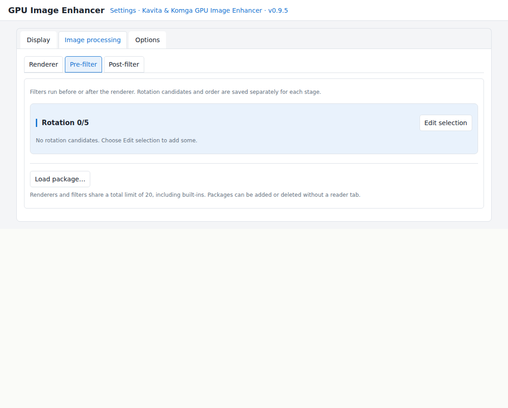
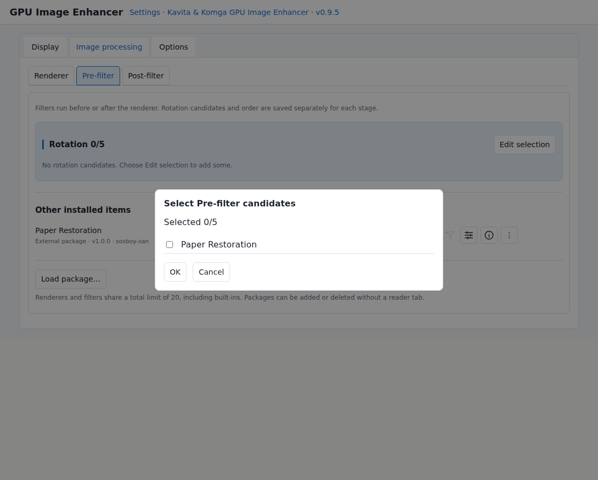

# Kavita & Komga GPU Image Enhancer

**More freedom. Better-looking comics in your browser.**

Kavita & Komga GPU Image Enhancer (GPUIE) is a browser extension for Kavita and Komga. Choose resizing methods such as LoHalo Jr. and NoHalo Jr., and combine them with filters before and after resizing, bringing advanced image-quality controls to your browser-based comic reader. It lets you adjust how comics look while keeping the site's layout and reading controls as much as possible.

The current extension version is **0.9.5 beta**. The public module API is **1.0**.

## What you can do

### Choose how images are resized

Select LoHalo Jr., NoHalo Jr., or another resizing method when fitting comic images to your screen. Lanczos3 is available as a separate module.

Compare text, lines, and screentones to find a method that suits the artwork and display size. Results vary with the image and scale.

#### Why LoHalo Jr. and NoHalo Jr.?

LoHalo Jr. and NoHalo Jr. are resizing implementations for GPUIE based on GEGL's LoHalo and NoHalo, which are used in GIMP.

During development, comparisons with GIMP output showed differences of about ±1 per pixel on an 8-bit scale for the test images. GPUIE handles resizing that preserves the aspect ratio; it does not port every operation supported by the originals.

The names LoHalo and NoHalo are retained out of respect for the original developers and their work. The “Jr.” suffix pays tribute to those algorithms while distinguishing these adapted implementations from complete ports of the originals.

### Combine filters before and after resizing

Images are processed in this order:

**Pre-filter → Renderer → Post-filter**

For example, you can adjust paper color before resizing, then sharpen edges at the final display size. Select a module for each stage and save its adjustment values.

### Switch settings while reading

Quick controls let you switch renderers and filters and adjust the selected filter without opening detailed settings each time.

Caching and prefetching prepare upcoming pages to help keep reading responsive while image processing is enabled.

### Add image-processing modules

Import external modules to add filters and renderers. The separately distributed module pack includes paper restoration and line-color adjustment.

## Compare actual results

### Screentones when downscaling

The same source image is downscaled from **1696×2528 to 1073×1600 pixels (about 63.3%)**. Compare moiré in the sky’s screentones, fine lines in the hair, clothing and scenery, and the text. No pre- or post-filters are enabled.

**Browser**

**LoHalo Jr.**

The [source artwork](../assets/comparisons/manga-original.jpg) was created with Gemini AI. The images were captured after actual downscaling with Browser and GPUIE’s LoHalo Jr.

README viewers may scale the images again. Use the [product page comparison](../index.html#compare-resize) to view at 1:1 pixels or switch between images. Results vary with the source, scale and display environment.

### Restore yellowed paper

Paper Restoration is an optional filter that brings yellowed paper closer to white. Compare the paper background as well as the printed colors.

| Before | After |
| --- | --- |
|  |  |

Source: *Super Duck* #2, as displayed in the official Komga demo. Both screenshots use LoHalo Jr., **1500×2250 → 898×1347 pixels (about 59.9%)**. Paper restoration uses automatic mode. Results vary by artwork; complete preservation of printed colors is not guaranteed.

## Tested environments

| Platform | Tested environment |
| --- | --- |
| Komga | v1.27.1-master, old GUI |
| Kavita | 0.9.1.4 |
| PC | Chrome 155.0.8059.80 (Official Build, 64-bit) |
| Android | Edge Canary 157.0.4333.0; CRX installation and operation tested experimentally |

Komga's new GUI has not been tested.

GPU processing requires features including WebGL2. The extension specifies Chrome 135 as its minimum version. Android requires a browser that can install extensions from CRX files.

**To confirm before publication:** reading modes tested on each site.

## Download and installation

| Package | Purpose |
| --- | --- |
| Extension ZIP | Extract and load in Chrome on PC |
| Extension CRX | For the tested Android browser |
| Module pack ZIP | Optional additional filters and renderers |

Additional modules are optional. LoHalo Jr., NoHalo Jr., and GPU Unsharp Mask are built in.

The official repository is [Kavita-Komga-GPU-Image-Enhancer](https://github.com/sosboy-san/Kavita-Komga-GPU-Image-Enhancer). Publication is being prepared; download links will be added when distribution begins.

### PC: Chrome

1. Download and extract the extension ZIP.
2. Open Chrome's extension management page.
3. Enable Developer mode.
4. Select **Load unpacked**, then choose the folder containing `manifest.json`.
5. Pin the extension to the toolbar if desired.

If the download bundle contains a separate extension ZIP, extract that ZIP too. Choose the extension folder containing `manifest.json` directly, rather than the full source folder.

### Android: Edge Canary

A CRX package is provided for Android. **CRX installation and operation have been tested with Edge Canary 157.0.4333.0.**

This is experimental use with a Canary build, not a guarantee of supported operation. Browser updates may change the installation method or prevent the extension from working.

### Using external modules

Allow GPUIE to run user scripts in the browser's extension settings. The location of this permission varies with the browser version. Without it, modules may be saved but cannot execute.

This browser permission is separate from the developer mode in GPUIE's detailed settings.

## First-time setup

### 1. Register your reading site

Open your Kavita or Komga tab and register the site from the extension menu. Check the server and installation path, then grant the requested site access permission.

GPUIE checks the registered port and path, including when different applications are installed on the same server. Manage registered sites in detailed settings.

### 2. Check whether the extension is ON

The extension is ON by default. Check that it is enabled on the registered site's reading page.

The toolbar icon shows the current tab's registration status and the extension's ON/OFF state.

| Icon | State |
| --- | --- |
|  Gray book and GPU | Unregistered site |
|  White book, gray GPU | Registered site; extension OFF |
|  White book, green GPU | Registered site; extension ON |

A green GPU means the extension is ON; it does not indicate that a render is currently running. GPUIE does not process every image on a registered site, such as images in its library listing.

### 3. Choose a renderer

**Browser is selected by default, with no filters selected.**

Try LoHalo Jr. or NoHalo Jr. and compare the results. Add filters as needed.

## Basic use

Show the site's reading menu to access the quick controls.

| Icon | Control | Action |
| --- | --- | --- |
|  | ON/OFF | Enable or disable image processing |
|  | Pre-filter | Switch the filter applied before resizing |
|  | Renderer | Switch the resizing method |
|  | Post-filter | Switch the filter applied after resizing |
|  | Adjustments | Open adjustments for the currently selected processing |
|  | HUD | Show or hide display-status information |
|  | Detailed settings | Configure candidates, placement, caching, language, and other options |

Renderer and filter controls cycle through the candidates selected in detailed settings. Each group can contain up to five quick candidates. Pre- and post-filters also have an OFF state.

Quick-control placement can be configured separately for portrait and landscape orientation.

### Adjust values

Change values in the filter's adjustment panel and apply them to save. Available parameters depend on the filter.

On PC, click or drag sliders, or enter numbers directly. Touch devices also support sliders and numeric entry. Controls beside numeric fields adapt to mouse and touch use.

When the same filter is used in both stages, its values are saved separately. An open adjustment panel follows the currently selected filter when you switch selections.

Read the module author's instructions and cautions in its Info panel.

### Return to reading from detailed settings

When opened from a reading tab, the top-left back control returns to that tab and closes the settings tab. When opened independently, it becomes a close control. Unapplied edits trigger a confirmation.

### Change the language

Choose Japanese, English, or Automatic. Automatic follows the browser language and uses English for unsupported languages. Confirming and saving a language change reloads the settings tab.

External modules use their own translations. Items without a translation for the selected language fall back to English.

## Built-in image processing

| Name | Purpose |
| --- | --- |
| Browser | Standard browser resizing |
| LoHalo Jr. | Resizing based on GEGL's LoHalo, adapted for comic reading |
| NoHalo Jr. | Resizing based on GEGL's NoHalo, adapted for comic reading |
| GPU Unsharp Mask | Edge adjustment after resizing |

### GPU Unsharp Mask

Adjust sharpening with radius, amount, and threshold.

| Parameter | Meaning | Default |
| --- | --- | --- |
| Radius | Gaussian sigma in output pixels | 3 |
| Amount | How much of the difference between the original and blurred image is added | 0.5 |
| Threshold | Difference threshold for each RGB component, in 8-bit levels | 0 |

It works with color and monochrome images. A radius or amount of zero passes the image through unchanged.

Excessive sharpening may make halos or grain more noticeable. Start with small changes.

## Additional modules

These three modules are **distributed separately from the extension**. Install only the ones you want.

| Name | Purpose |
| --- | --- |
| Paper Restoration | Bring yellowed paper closer to white and correct variations in paper tint |
| Monochrome Line Color | Adjust line color and darkness on monochrome pages while protecting pages identified as color |
| Lanczos3 | Add another resizing method |

### Paper Restoration

Estimates paper color for each image and corrects it automatically. You can also set a reference color manually. It reduces yellowing while trying to preserve printed colors and dark lines.

Printed colors are not completely protected. Colors similar to the paper tint may change; adjust correction strength and color protection as needed.

### Monochrome Line Color

Changes line color and darkness on images classified as monochrome. Modes vary the strength of color-page protection, and a forced mode applies the filter regardless of classification.

Automatic classification is not infallible. Small colored areas may be missed. Choose a mode appropriate for the artwork.

### Add a package: a quick walkthrough

Before using external modules for the first time, allow user-script execution for GPUIE in your browser’s extension settings.

1. **Extract the module pack.** Locate the `.js` or `.txt` file for the module you want.
2. **Open Image processing in detailed settings.** Choose Renderer for a resizing module, or Pre-filter / Post-filter for a filter.
3. **Choose “Load package…” and select the file.** Select the extracted module file, not the ZIP.

4. **Add it to the rotation.** Choose “Edit selection”, check the new module, and confirm with “OK”.

5. **Switch to it while reading.** Use the corresponding quick icon to select the module, then open Adjust to change its settings.

Screens reproduce the current UI implementation for this guide. Layout may differ on PC and touch devices. See the module’s Info for usage details.

The limit is 20 modules in total, including built-ins. Each file must be no larger than 1 MiB.

**External modules are executable JavaScript. Use modules only from sources you trust.** Declaration checks and processing isolation do not guarantee that arbitrary code is safe.

## Performance and memory settings

### Processed-image format

| Format | Characteristics |
| --- | --- |
| PNG | Avoids quality loss from output compression; default |
| JPEG | Quality 90; prioritizes speed and cache capacity; transparent areas become white |

This setting controls the processed-image format. Relative speed depends on the device and image.

### Caching and prefetching

Nearby images are held decoded. More distant forward images are prepared in compressed form.

| Setting | Options and default |
| --- | --- |
| Decoded-image retention | 2, 4, or 8 images in each direction; default 4 forward / 4 backward |
| Compressed-image capacity | 64, 128, or 256 MB; default 128 MB for PNG, 64 MB for JPEG |

Currently displayed images are managed separately from the retention count. Compressed-image capacity can be set for each format. Prioritizing the current image may temporarily exceed the selected capacity.

Prefetching works in the ordinary reading view. In the site's fullscreen view, processing can continue further ahead after the display size settles.

Cache capacity is not a limit on the browser's total memory use.

### Processing mode and time limits

Processing normally runs in a Worker. The processing time limit is 1–60 seconds, with a default of 10 seconds. Image encoding has a separate 30-second limit.

Speed-priority mode cannot forcibly stop long synchronous JavaScript. Some external modules may make the interface unresponsive for an extended period; use this mode with care.

## Troubleshooting and limitations

### No visible change in image quality

- Check that the site is registered and access permission has been granted.
- Check that the extension is ON and a renderer other than Browser or a filter is selected.
- Check that adjustments were applied and no error or size limit is reported.

At a 1:1 scale, renderer resizing is skipped. Selected filters still run.

### An external module does not run

Check the browser's user-script permission, API compatibility, and the reported error. Reload the reading tab if necessary.

### Processing fails or is slow

Image size, device GPU, and selected processing affect speed and memory requirements. Ordinary processing failures fall back to the original image.

Try lighter settings, remove filters, or select JPEG output. If needed, retry image processing from general settings.

### Image size and scope

GPUIE targets Kavita and Komga reader images rather than processing images across general web pages.

| Limit | Value |
| --- | --- |
| Current-image output | Up to 64 million pixels |
| Prefetched-image output | Up to 16 million pixels |
| GPU dimensions | Subject to device and browser limits |
| GPU processing memory budget | 512 MiB; not a browser-wide RAM limit |
| Processing time | Subject to the configured time limit |

For large images, the current page may display even when nearby pages cannot be prepared.

### Other limitations

- Komga's new GUI has not been tested.
- Changes to a site's page structure may prevent operation.

When reporting a problem, include extension, site, and browser versions; reading mode; modules used; and reproduction steps. Do not publish logs containing authentication or personal information without checking them.

**To confirm before publication:** the issue-reporting link.

## Permissions and data handling

| Permission | Purpose |
| --- | --- |
| storage | Save settings, registered sites, and additional modules |
| scripting | Load processing code into registered sites |
| activeTab | Access the current tab when the user invokes the extension |
| userScripts | Execute external modules |
| Optional HTTP/HTTPS host permissions | Connect to servers registered by the user |

The declared host-permission scope is broad because users can register their own servers. Site access is granted during registration. Browser permission is host-based; GPUIE also checks the registered port and installation path.

Settings and additional modules are stored locally in the browser. Processed-image caches are held within the reading page. Original image files are not modified.

Built-in image processing does not send images to an external image-processing service. Page information is retrieved using the registered site's API and existing login session.

### Diagnostics

Developer diagnostics are normally OFF. When enabled, they show analysis results and processing times and allow JSON copying or saving. Records are kept in the reading page's memory and disappear when the page is reloaded or closed.

The extension does not add image URLs, authentication details, file paths, or pixels to diagnostic JSON. Strings returned by external modules may be included; inspect the contents before sharing.

## Licenses and credits

Author: **sosboy-san**

LoHalo Jr. and NoHalo Jr. are based on GEGL implementations and retain the original author credits and LGPL-3.0-or-later notices. Portions derived from Crisp Images are under the MIT license.

See the bundled documents and each module's Info panel for original authors, sources, and license texts.

GPUIE development, adaptation, modifications, and maintenance are handled by sosboy-san. The original author of Crisp Images-derived portions is Ikkoru (previously credited as Igkor Bevzenidis). The original algorithms and code behind LoHalo Jr. and NoHalo Jr. are by GEGL's respective authors. These credits do not imply an official GPUIE release, endorsement, or support by the original authors. Please report GPUIE issues to the GPUIE project.

GPU Unsharp Mask, Paper Restoration, and Monochrome Line Color are distributed under the MIT license. Third-party portions retain their respective license notices.

Development assistance: OpenAI ChatGPT / Codex, used in design discussions, implementation, testing, and documentation.

Independently authored core code, README, public API documentation and the official introduction page are also MIT-licensed. Third-party-derived code retains its existing licenses. Comic images and other third-party comparison assets are excluded from this MIT declaration. See [license scope](LICENSE.md) and [third-party notices](THIRD-PARTY-NOTICES.md).

## Creating modules

The public GPU module API 1.0 supports renderers and filters, generated adjustment panels, CPU analysis of original images, and GPU processing using analysis results.

English display information is required. Modules can include additional languages such as Japanese.

See the [public GPU module API specification 1.0 (Japanese)](GPU-Module-API-Spec-ja-1.0.md). The separately distributed modules also serve as implementation examples.
